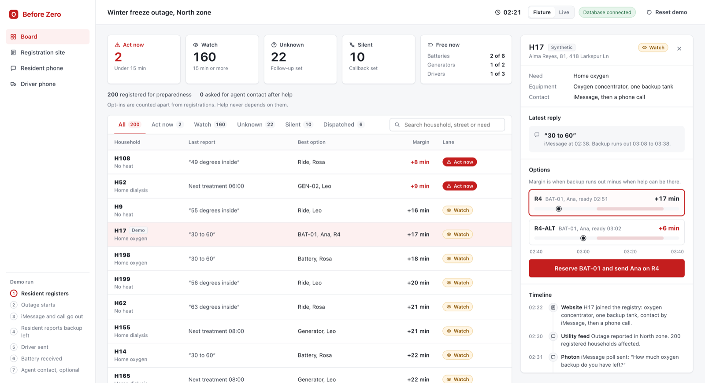
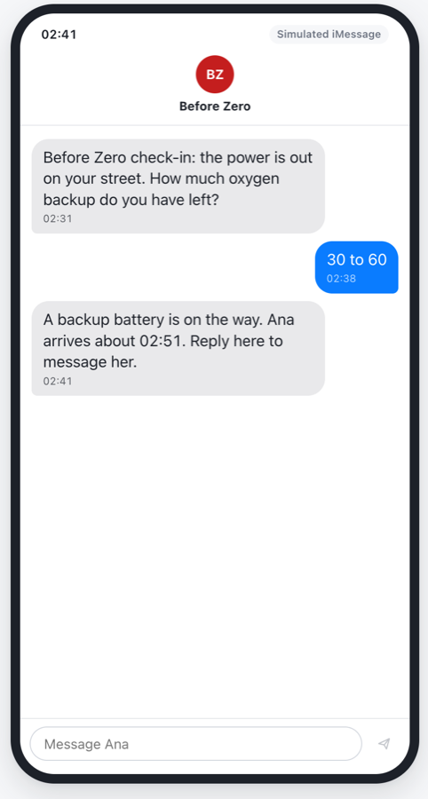
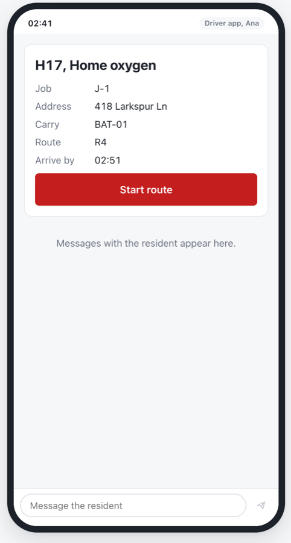

# Before Zero

When the power goes out, some households have a deadline: an oxygen concentrator on a backup battery, a dialysis treatment, a home that is losing heat. Before Zero checks in with every registered household over iMessage. It turns each reply into a time window, compares that window with how fast the right resource can reach them, and ranks the whole outage by that margin. The coordinator sees who runs out first, reserves the last battery for one house only, and follows up with anyone who goes silent.

**AI reads, code decides.** Reading a reply (`"30 to 60 minutes left"`) is the only fuzzy step, and even that is plain rules today. Every ranking, reservation and follow-up is deterministic code you can test.

All people, addresses, phone numbers and policy data in this repo are synthetic.

## Demo

| Coordinator board | Resident (iMessage) | Driver |
|---|---|---|
|  |  |  |

Video: added with the Devpost submission.

The demo story, in fixture mode:
1. Register H17 (home oxygen) on the **Registration site**.
2. On the **Board**, start the outage. The **Resident phone** receives the check-in.
3. Answer **30 to 60**. H17 lands in Watch, with R4 at +17 min and R4-ALT at +6 min.
4. Reserve BAT-01 and send Ana. The resident gets the ETA, and the **Driver phone** gets the job.
5. The driver reports a detour, then arrives. The resident confirms delivery and can optionally ask for a State Farm agent.

## How it works

```
iMessage ──► Photon bridge ──► SpacetimeDB module ──► React screens
             (B)               (A)  ▲                 (D)
                                    │
                               dispatch rules (C)
```

| Part | What it does | Where |
|---|---|---|
| Photon bridge | Reads iMessage replies, turns them into check-ins and texts the ETA when a job is reserved | [`backend/bridge/`](backend/bridge/README.md) |
| SpacetimeDB module | Private tables, a view per role, atomic `reserve`, the job thread, consent and silent follow-ups | [`spacetimedb/src/index.ts`](spacetimedb/src/index.ts), [`docs/setup.md`](docs/setup.md) |
| Dispatch rules | Pure TypeScript: ready time, margin, and Act now / Watch / Unknown / Silent lanes | [`spacetimedb/src/domain/`](spacetimedb/src/domain/) |
| Screens | Coordinator board, resident phone, driver phone and registration site, in fixture or live mode | [`src/`](src/) |

**Margin** = the earliest time backup may run out, minus when help can be there, in whole minutes. Under +15 minutes is **Act now**, and so is a case where no compatible resource is free. "Not sure" stays **Unknown**. A household whose check-in round passes its due time without a reply is **Silent**, and it gets a callback owner who keeps it until it is answered.

## Sponsor technology and how to tell it ran

| Sponsor | What we use | How to tell it ran |
|---|---|---|
| **SpacetimeDB** | The whole backend: tables, reducers, a view per role, a scheduled sweep for silent households | In **Live** mode the chip shows your role, and the board, phones and job thread update in every window without a refresh. Two coordinators reserving the last battery get one job and one `conflict:` message (`npm run check:tl05`). |
| **Photon** | iMessage check-ins in, ETA texts out | `npm run live` in `backend/bridge` uses the real iMessage line. `npm run replay` only replays a synthetic fixture and never messages anyone. Each live check-in's `eventId` is the Photon message ID. |
| **State Farm** | Preparedness registration, and an optional agent-contact offer after help is delivered (prototype only) | The resident sees the offer only after delivery. A receipt `L-<id>` appears if they agree, and Skip saves nothing. The coordinator sees counts only, never who asked, and help never depends on the answer. |

## Run it

Node 22.23.4+ or 24.22.1+.

**Fixture mode** needs no database and no keys:

```bash
npm install
npm run dev        # http://localhost:5173
```

Open the board, use the left rail to switch screens, and use **Reset demo** to start over. The chip says "Database offline", which is expected in fixture mode.

**Live mode** runs against a SpacetimeDB database:

```bash
cp .env.example .env.local      # local: ws://localhost:3000, database time-left
spacetime start                 # separate terminal
npm run stdb:publish:local      # publish and seed
npm run dev
```

Click **Live**. Each screen asks for an invite code. The database owner creates single-use codes (`npm run demo:invites`) and shares them privately; they are never committed. Each screen keeps its own role, so a second driver or resident needs another browser.

Reset to the seed with `npm run demo:reset` (owner only). The full setup, Maincloud settings, roles and acceptance checks (`npm run check:tl01` … `check:tl18`) are in [`docs/setup.md`](docs/setup.md).

Tests for the dispatch rules: `npx tsx --test fixtures/*.test.ts`. Bridge tests: `npm test` in `backend/bridge`.

## Data

Everything is synthetic: households, names, addresses, phone numbers (555 range), routes and policy signals. No real resident, customer or insurance data is used anywhere, and invite codes and tokens stay out of the repo.

## Team

| Member | Built |
|---|---|
| A, [@gholapksh](https://github.com/gholapksh) | SpacetimeDB module: schema, role views, atomic reserve, job thread, consent, silent follow-ups, demo reset |
| B, [@AnkithaThomas](https://github.com/AnkithaThomas) | Photon bridge: iMessage check-ins, ETA texts, idempotent sends, synthetic replay |
| C, [@KsAashrith87](https://github.com/KsAashrith87) | Dispatch rules and lanes, disaster fixtures and tests, policy-signal suggestions, pitch |
| D, [@SJAryan](https://github.com/SJAryan) | Coordinator board, resident and driver phones, registration site, fixture and live modes, submission |

## Known gaps

- The live seed has the two story households per incident. The ~200-household board appears in fixture mode only ([#41](https://github.com/SJAryan/HackUTD26/issues/41)).
- Reading replies is rule-based. A model can replace the reading later, never the decision.
- In live mode the driver doesn't see the registered address yet ([#40](https://github.com/SJAryan/HackUTD26/issues/40)).
- Policy-based need suggestions are a fixture-mode prototype. Live mode doesn't store the confirmation yet ([#27](https://github.com/SJAryan/HackUTD26/issues/27)).
- Voice escalation for a missed check-in is not built ([#14](https://github.com/SJAryan/HackUTD26/issues/14)).
- The Photon line is a shared beta test line, and only consenting teammates text it.
